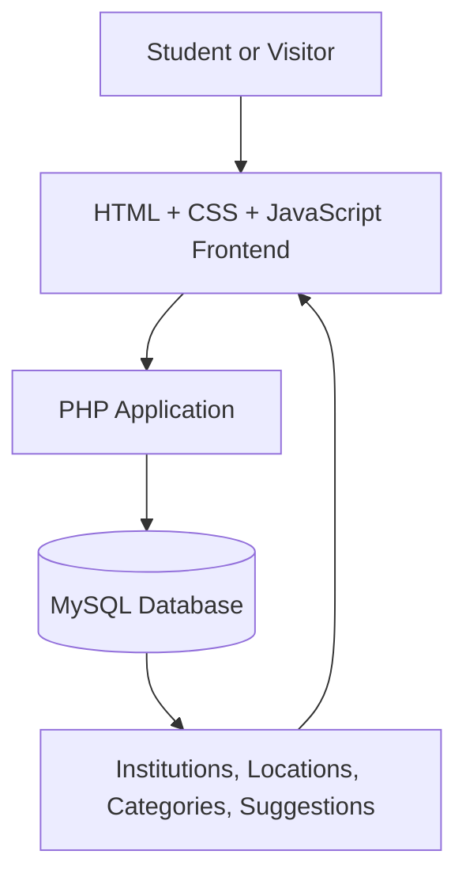

# EduTricity — Complete System Architecture

**Project:** EduTricity  
**Organization:** EDU-sector  
**Repository:** `edu-center-`  
**Project type:** Education Discovery Platform  
**Initial geographical scope:** Chandigarh, Mohali (SAS Nagar), and Panchkula  
**Current phase:** PHP + MySQL implementation, database-backed institution discovery, and frontend refinement

---

## 1. Project Overview

EduTricity is a PHP-based education discovery platform built to help students explore, search, and compare educational institutions in the Chandigarh Tricity region.

The application focuses on structured, reliable institution data without introducing a separate AI chatbot layer. The project is currently built around PHP for backend logic, MySQL for persistent storage, and HTML/CSS/DOM rendering for the frontend.

The platform is designed to support:
- institutional discovery
- city and category filtering
- comparison of institutions
- suggestion submissions from users
- future expansion into more advanced data management and admin workflows

---

## 2. Project Objectives

1. Provide a central platform for discovering educational institutions.
2. Enable institution search and filtering by location, category, and ownership.
3. Present institution profiles with available course information, fees, and source links.
4. Support side-by-side institution comparisons.
5. Provide search and browse functionality across Chandigarh, Mohali, and Panchkula.
6. Let users suggest missing or new institutions.
7. Keep the application reliable, secure, and easy to maintain.
8. Stay aligned with the project’s actual technology stack: PHP + MySQL + DOM.

---

## 3. Functional Requirements

### 3.1 Education Discovery

- Search institutions by name, city, or category.
- Browse schools, colleges, universities, coaching institutes, and skill-development institutions.
- Filter institutions by location and ownership where applicable.
- View institution details and available information.

### 3.2 Institution Comparison

- Compare selected institutions side by side.
- Compare academic focus, ownership, city, and fee range.
- Display consistent fields across institutions.
- Let the UI surface missing or limited data clearly.

### 3.3 Location-Based Discovery

- Browse institutions in Chandigarh, Mohali, and Panchkula.
- Support search and listing by location.
- Organise city data so the UI can filter by region.

### 3.4 Institution Suggestions

- Allow users to suggest institutions for review.
- Store submitted records in a MySQL suggestions table.
- Review entries before publishing them as trusted records.

### 3.5 Project Scope Notes

- The AI assistant is not part of the current production stack.
- The current project is intentionally focused on education discovery and comparison, not chatbot-driven intelligence.

---

## 4. High-Level System Architecture

The system is composed of the following components:

1. Frontend HTML, CSS, and JavaScript
2. PHP application backend
3. MySQL database
4. File-based project structure for content and assets

### 4.1 Architecture Diagram



This is the current logical architecture for the project.

---

## 5. Frontend Architecture

### 5.1 Technology Stack

- HTML5
- CSS3
- Vanilla JavaScript
- PHP-rendered page templates
- Responsive design for desktop and mobile browsers

### 5.2 Main Interface Components

**Homepage**
- Navigation and branding
- Search bar
- Info sidebar
- Education-sector cards
- Featured institution cards
- Comparison panel
- FAQ section
- Suggest an institution form

**Institution Listing**
- Search results loaded from MySQL
- Institution cards with key metadata
- Ownership and city information
- Fee and website display

**Comparison View**
- Side-by-side information for selected institutions
- Consistent presentation of institutional information

**Suggestion Form**
- User input for institution name, location, and details
- POST handling through PHP
- Storage in MySQL suggestions table

### 5.3 Frontend Responsibilities

The frontend is responsible for:
- presentation
- user interaction
- layout and responsiveness
- form submission
- lightweight DOM enhancements

It does not contain database logic or credentials.

---

## 6. PHP Backend Architecture

### 6.1 Purpose

The PHP backend handles the conventional website functionality for the project.

Responsibilities include:
- rendering the homepage
- connecting to MySQL
- retrieving institution records
- handling search/filter queries
- processing suggestion submissions
- server-side validation

### 6.2 Current Internal Structure

```text
project/
├── config/
│   └── database.php
├── database/
│   └── schema.sql
├── includes/
│   ├── header.php
│   └── footer.php
├── assets/
│   ├── css/
│   └── js/
├── index.php
├── process-suggestion.php
├── README.md
├── docs/
│   └── architecture.md
└── .gitignore
```

This structure is the current working architecture for the app.

### 6.3 Database Access

- Use PDO with prepared statements.
- Centralise connection settings in `config/database.php`.
- Validate inputs before database writes.
- Keep the database credentials outside public code when deployed.

---

## 7. Database Architecture

### 7.1 Core Tables

**locations**
- id
- city
- state
- created_at

**categories**
- id
- name
- created_at

**institutions**
- id
- name
- city_id
- category_id
- ownership
- description
- fee_range
- website
- created_at

**suggestions**
- id
- institution_name
- location
- details
- status
- created_at

### 7.2 Data Quality Rules

- Store only validated institution data.
- Use consistent city and category references.
- Keep pricing and description fields clear and human-readable.
- Track suggestion records separately before they are promoted to trusted records.

---

## 8. Request Flow

### Homepage Request

1. User visits `index.php`.
2. PHP connects to MySQL.
3. Query fetches institutions with related city and category data.
4. The page renders the institution cards dynamically.
5. The frontend displays a search-ready homepage.

### Suggestion Request

1. User submits the form from the homepage.
2. `process-suggestion.php` receives the POST data.
3. Input is validated server-side.
4. Data is inserted into the `suggestions` table.
5. User is redirected back to the homepage.

---

## 9. Security Architecture

### Database Security

- Use prepared statements.
- Restrict database privileges to the minimum required.
- Avoid raw SQL concatenation with user input.

### Application Security

- Validate user-submitted fields.
- Use `htmlspecialchars()` when rendering user input.
- Avoid exposing internal stack traces to users.

### Repository Security

- Do not commit private credentials or local configuration secrets.
- Use `.gitignore` for local environment files.

---

## 10. Testing and Validation

### Recommended checks

- Verify database connectivity using the config file.
- Test homepage rendering with and without search parameters.
- Validate suggestion insertion and redirect flow.
- Ensure HTML output escapes user-submitted values.
- Confirm that layout remains responsive across screen sizes.

---

## 11. Deployment Architecture

### Development Environment

- PHP runtime
- MySQL database
- Browser-based frontend testing
- Local project files and repo checkout

### Planned Production Environment

- PHP-compatible hosting
- Managed MySQL instance
- Static asset hosting or shared hosting deployment
- Secure environment configuration for DB credentials

---

## 12. Implementation Roadmap

### Phase 1 — Foundation
- Finalise repository structure.
- Configure PHP and MySQL connection.
- Add the initial schema and sample data.

### Phase 2 — Core Website
- Homepage and search flow.
- Institution listing page.
- Suggestion form and backend handling.

### Phase 3 — Comparison and Expansion
- Add institution comparison flow.
- Improve filtering and information quality.
- Add admin review for suggestions.

### Phase 4 — Data Quality and Scale
- Add stronger validation and moderation.
- Expand database records.
- Improve UI and data presentation.

---

## 13. Current Project Status

This document reflects the current implementation direction for the project.

The application is now aligned to the actual stack:
- PHP
- MySQL
- DOM-based HTML rendering
- no AI chatbot layer in the current app

The current focus is on building a reliable education-discovery interface backed by a MySQL database and PHP-based server logic.
