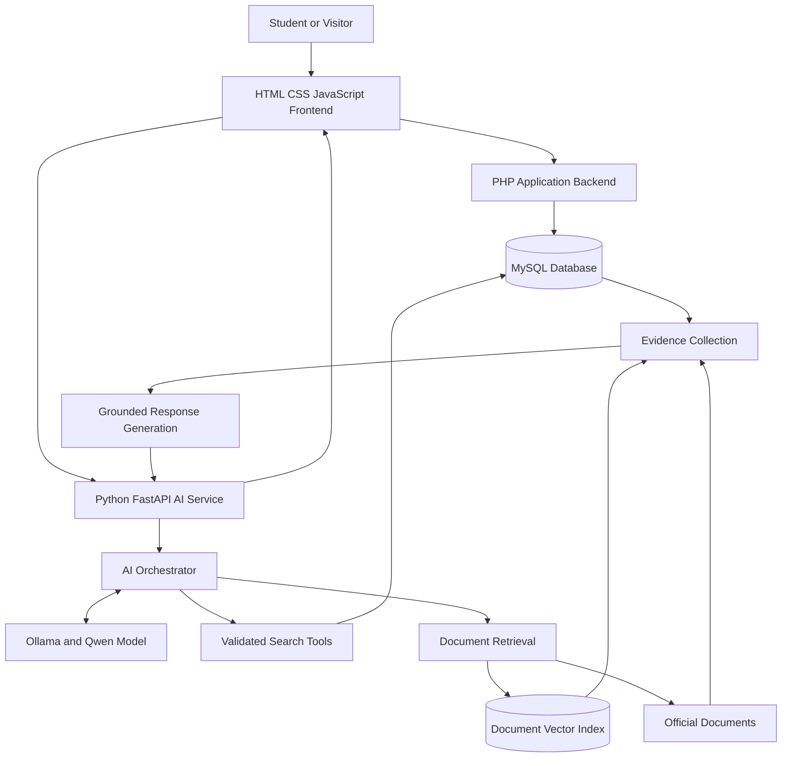

# EduTricity — Complete System Architecture

**Project:** EduTricity  
**Organization:** EDU-sector  
**Repository:** `edu-center-`  
**Project type:** Education Discovery and Intelligence Platform  
**Initial geographical scope:** Chandigarh, Mohali (SAS Nagar), and Panchkula  
**Current phase:** Repository setup, architecture planning, and existing-application audit

---

## 1. Project Overview

EduTricity is a web-based education discovery platform designed to help students find, explore, and compare educational institutions in the Chandigarh Tricity region.

The platform aims to centralise information about schools, colleges, universities, coaching institutes, and skill-development institutes. It will combine structured education data with an AI-powered conversational assistant to help students make informed decisions.

The project builds on an existing HTML, CSS, JavaScript, PHP, and MySQL website. A separate Python-based AI service is planned to provide conversational search, evidence-based recommendations, and retrieval from official admission documents.

The system will be developed collaboratively through GitHub.

## 2. Project Objectives

1. Provide a central platform for discovering educational institutions.
2. Enable institution search and filtering by location, education sector, and ownership.
3. Present institution profiles with available courses, fees, eligibility requirements, and other relevant information.
4. Support side-by-side institution comparisons.
5. Provide map-based institution discovery.
6. Develop an AI assistant that understands natural-language education queries.
7. Retrieve current information from structured records and official documents.
8. Maintain source provenance and data verification dates.
9. Develop a secure, modular, testable, and maintainable application.
10. Enable multiple contributors to work through a shared repository and structured review process.

## 3. Functional Requirements

### 3.1 Education Discovery

- Search institutions by name, course, location, and supported categories.
- Browse schools, colleges, universities, coaching institutes, and skill-development institutes.
- Filter institutions by government or private ownership.
- Distinguish institutional ownership from university affiliation.
- View institution details and official website links.

### 3.2 Institution Comparison

- Select multiple institutions for comparison.
- Compare available courses, fees, eligibility, facilities, and other supported attributes.
- Display consistent fields across selected institutions.
- Identify missing, unavailable, or unverified information.
- Allow users to remove institutions and update their comparison list.

### 3.3 Location-Based Discovery

- Browse institutions in Chandigarh, Mohali, and Panchkula.
- Display institution locations and addresses.
- Support map-based search and location filters.
- Use a mapping provider or map library selected during implementation.
- Request browser geolocation only with user permission when necessary.

### 3.4 Institution Suggestions and Information

- Allow users to suggest institutions.
- Provide FAQs, contact information, and About Us content.
- Validate submitted data and moderate suggestions before publishing them.

### 3.5 AI Education Assistant

- Accept natural-language questions.
- Interpret course, location, budget, ownership, and other supported constraints.
- Search structured institution records through approved tools.
- Handle conversational follow-up questions.
- Compare retrieved options and explain the results.
- Retrieve information from official admission documents.
- Provide source links and verification dates where available.
- Explicitly identify unknown or unverified facts.

These features are planned and will be implemented incrementally.

## 4. High-Level System Architecture

The system consists of the following components:

1. Frontend application
2. Existing PHP backend
3. MySQL database
4. Python FastAPI AI service
5. Ollama language-model runtime
6. Structured retrieval and comparison tools
7. Document ingestion and retrieval subsystem
8. Testing, logging, and deployment infrastructure

### 4.1 Architecture Diagram



This is a logical architecture. The components may run on separate hosts in production.

## 5. Frontend Architecture

### 5.1 Technology Stack

- HTML5
- CSS3
- Vanilla JavaScript
- Fetch API for backend communication
- Responsive layouts for desktop and mobile browsers

The existing frontend should be preserved wherever practical. A framework such as React is not required for the initial implementation.

### 5.2 Main Interface Components

The frontend will follow the original project wireframe.

**Homepage**
- Navigation and branding
- Search bar
- Info sidebar
- Education-sector cards
- Nearby institution panel
- Comparison panel
- College section

**Institution Listing Page**
- Institution cards
- Search and filter controls
- Ownership and location filters
- Add-to-comparison controls

**Institution Detail Page**
- Institution overview
- Courses and fees
- Eligibility and admissions
- Facilities and reviews, where reliable data exists
- Official website and source references

**Comparison Page**
- Side-by-side institution data
- Consistent comparison attributes
- Missing-data indicators
- Add and remove institution controls

**Map Page**
- Map display
- Location search
- Institution markers
- Institution details from selected markers

**AI Assistant**
- Chat input
- Conversation history
- Loading and error states
- Structured search results
- Comparison summaries
- Source links and verification dates

### 5.3 Frontend Responsibilities

The frontend is responsible for presentation, user interactions, input collection, and displaying API responses.

It must not connect directly to MySQL or contain database credentials.

## 6. PHP Backend Architecture

### 6.1 Purpose

The existing PHP backend will continue to handle the conventional website functionality.

Responsibilities include:

- Institution and course APIs
- User registration and authentication, if required
- Saved institutions and comparison lists
- Institution suggestion submissions
- Server-side validation and access control
- Database access and application logic

### 6.2 Proposed Internal Structure

```text
backend-php/
├── public/
├── src/
│   ├── Controllers/
│   ├── Services/
│   ├── Repositories/
│   ├── Middleware/
│   └── Validators/
├── routes/
├── config/
├── tests/
└── README.md
```

This is a proposed structure. The current PHP application must be audited before moving files or reorganising existing code.

### 6.3 Database Access

- Use PDO and prepared statements.
- Validate inputs before database operations.
- Keep database credentials outside tracked source files.
- Use a central connection configuration.
- Separate request handling from database queries.
- Apply authentication and authorisation on the server.

## 7. Python AI Service Architecture

### 7.1 Technology Stack

- Python
- FastAPI
- Pydantic
- Ollama
- Qwen3 4B quantized as an initial model candidate
- Pytest for testing

The model will run locally during development. Model selection will be based on retrieval accuracy, tool-calling reliability, latency, and available hardware resources.

### 7.2 Proposed Internal Structure

```text
ai-service/
├── app/
│   ├── main.py
│   ├── api/
│   │   ├── chat.py
│   │   └── health.py
│   ├── core/
│   │   ├── config.py
│   │   └── logging.py
│   ├── orchestrator/
│   │   ├── conversation.py
│   │   └── tool_dispatcher.py
│   ├── tools/
│   │   ├── search_institutions.py
│   │   ├── compare_institutions.py
│   │   ├── get_course_details.py
│   │   └── get_admission_information.py
│   ├── retrieval/
│   │   ├── structured_search.py
│   │   └── document_search.py
│   ├── llm/
│   │   └── ollama_client.py
│   ├── schemas/
│   └── security/
├── tests/
├── requirements.txt
└── README.md
```

### 7.3 AI Request Flow

1. Receive and validate the user's request.
2. Load the appropriate conversation context.
3. Ask the model to interpret the question and select an approved tool if needed.
4. Validate the selected tool and its arguments.
5. Retrieve information from MySQL or the document index.
6. Supply the retrieved evidence to the model.
7. Generate a response grounded in that evidence.
8. Return the answer, structured results, source references, and limitations.

The language model must not receive unrestricted database access or execute arbitrary SQL.

## 8. AI Tools and Structured Retrieval

The initial chatbot will use a small set of explicitly defined tools.

| Tool | Responsibility |
|---|---|
| `search_institutions` | Search institutions using supported filters |
| `compare_institutions` | Compare selected institution records |
| `get_course_details` | Retrieve course-specific information |
| `get_admission_information` | Retrieve available admission information and relevant documents |

Each tool will have a typed input schema, validated arguments, bounded results, and defined error handling.

### 8.1 Structured Search

MySQL will remain the source of truth for institution records, courses, fees, locations, and other structured information.

Queries must use parameterised SQL and an appropriately restricted database account.

### 8.2 Document Retrieval

Document retrieval will be added after the structured chatbot works reliably.

Planned components:

- PyMuPDF for PDF text extraction
- Sentence Transformers for embeddings
- ChromaDB for vector indexing and similarity search
- Source metadata for citations and verification

Retrieved passages will be supplied to the model as evidence. Document content must be treated as untrusted input rather than instructions to execute.

### 8.3 Model Constraints

- Do not fine-tune the model to memorise changing institution data.
- Retrieve current records at query time.
- Benchmark candidate models on the same evaluation dataset.
- Explicitly identify missing information.
- Avoid unsupported rankings, fees, deadlines, or eligibility claims.

## 9. Database Architecture

### 9.1 Core Entities

The final schema will be defined after inspecting the existing MySQL database.

Proposed entities include:

**Institutions**
- Institution ID
- Institution name
- Institution type
- Ownership
- Address and location
- Official website
- Verification status

**Courses**
- Course ID
- Institution ID
- Course name
- Academic level
- Duration
- Eligibility requirements

**Fees**
- Fee record ID
- Institution or course reference
- Academic year
- Fee amount
- Fee category
- Source reference

**Admissions**
- Admission record ID
- Institution or course reference
- Admission route
- Requirements
- Relevant dates
- Academic year
- Source reference

**Sources**
- Source ID
- Source URL
- Source type
- Publication date, where available
- Last-verified date
- Related institution or record

**Users and User Selections**
- User records, if accounts are implemented
- Saved institutions
- Comparison lists

### 9.2 Data Quality

- Store the source of important factual claims.
- Track academic years for time-sensitive information.
- Distinguish unknown values from confirmed zero values.
- Avoid presenting estimates as verified facts.
- Establish a process for correcting outdated records.

## 10. API Design

The following endpoints are proposed. Their exact contracts will be documented before implementation.

| Method | Endpoint | Purpose |
|---|---|---|
| GET | `/api/institutions` | Search and filter institutions |
| GET | `/api/institutions/{id}` | Retrieve institution details |
| GET | `/api/institutions/{id}/courses` | Retrieve courses |
| POST | `/api/compare` | Compare selected institutions |
| GET | `/api/locations` | Retrieve supported locations |
| POST | `/api/suggestions` | Submit an institution suggestion |
| POST | `/api/chat` | Submit a chatbot message |
| GET | `/health` | Check service health |

The final endpoints may be separated between the PHP backend and Python AI service. Authentication, validation, error responses, and rate limits must be specified in the API design.

### Example Chat Request

```json
{
  "conversation_id": "example-session",
  "message": "Find affordable CSE colleges in Mohali"
}
```

The response should contain a grounded answer, relevant structured results, source references where available, and explicit limitations.

## 11. Data Ingestion and Verification

A separate data-maintenance process will support the platform.

Responsibilities include:

- Collecting institution information from permitted sources
- Importing records into the database
- Validating required fields
- Detecting duplicate institutions
- Tracking source URLs and verification dates
- Correcting outdated records
- Maintaining academic-year-specific information

Automated extraction or scraping must comply with applicable website terms, access restrictions, and copyright requirements.

Institution suggestions submitted by users must be reviewed before becoming trusted public records.

## 12. Security Architecture

Security will be implemented across all services.

### Database Security
- Prepared statements
- Restricted database accounts
- No unrestricted SQL execution by the model
- Protected credentials
- Backups and migration discipline

### API Security
- Input validation
- Request-size limits
- Timeouts and rate limits
- Server-side authentication and authorisation
- Appropriate CORS configuration
- Safe error messages

### AI Security
- Allow-listed tools
- Strict argument validation
- Bounded query results
- Prompt-injection testing
- Separation of instructions from retrieved evidence
- Verification of tool outputs before generating factual answers

### Repository Security
- Exclude `.env` and local secrets from Git
- Commit only placeholder configuration in `.env.example`
- Never commit private database dumps or model weights
- Review dependency updates and security advisories

## 13. Testing and Evaluation

### Unit Testing
Test individual functions, validators, repositories, and tool implementations.

### API Testing
Verify request validation, responses, error handling, permissions, and database interactions.

### Integration Testing
Test the frontend, PHP backend, MySQL database, and Python AI service together.

### Chatbot Evaluation
Maintain a dataset of realistic student questions covering:

- Institution search
- Location and ownership constraints
- Budget-related queries
- Institution comparisons
- Conversational follow-ups
- Missing or outdated information
- Tool-calling failures
- Prompt-injection attempts

Evaluate retrieval accuracy, constraint satisfaction, unsupported claims, tool correctness, latency, and graceful failure.

## 14. Deployment Architecture

### Development Environment

- Frontend: Local browser
- PHP: XAMPP or compatible local server
- Database: Local MySQL
- AI service: Local Python environment and FastAPI
- Model runtime: Ollama on the development machine

### Planned Production Environment

- Frontend: Vercel for static frontend assets
- PHP backend: PHP-compatible hosting
- Database: Managed or securely hosted MySQL
- AI service: Reachable Python hosting
- Inference: Secure host with sufficient compute resources
- Document index: Persistent storage or a suitable managed service

Vercel does not natively provide a conventional PHP application runtime as its standard deployment model. The PHP backend must therefore be hosted separately in this architecture.

A local Ollama instance is suitable for development, but public users will need a reachable inference service. Free, always-on inference is not guaranteed.

## 15. Team Collaboration Workflow

The project will be managed through the EDU-sector GitHub organization.

### Branching Strategy

- `main`: Stable, reviewed code
- `feat/<feature-name>`: New functionality
- `fix/<issue-name>`: Bug fixes
- `docs/<document-name>`: Documentation updates

### Development Workflow

1. Create or select a GitHub Issue.
2. Assign an owner and define acceptance criteria.
3. Create a feature branch.
4. Implement and test the change.
5. Commit using a descriptive message.
6. Open a pull request.
7. Review code and required checks.
8. Merge approved changes into `main`.

The team must agree on database schemas and API contracts before implementing interdependent components in parallel.

## 16. Implementation Roadmap

### Phase 1 — Foundation
- Configure the GitHub repository.
- Document the current application and database.
- Define API and architecture decisions.
- Establish team permissions and workflow.

### Phase 2 — Core Website
- Implement the homepage.
- Build institution search and filtering.
- Add institution detail pages.
- Implement comparison functionality.

### Phase 3 — Backend Reliability
- Audit PHP database access.
- Improve validation and query safety.
- Establish stable API contracts.
- Add backend tests.

### Phase 4 — AI Chatbot MVP
- Set up FastAPI.
- Connect Ollama and the selected model.
- Implement validated search tools.
- Return evidence-grounded answers.

### Phase 5 — Advanced Intelligence
- Add official-document retrieval.
- Implement explainable recommendations.
- Improve conversational context.
- Build a repeatable evaluation suite.

### Phase 6 — Deployment
- Deploy the frontend and backend services.
- Configure secure environment variables.
- Test the deployed application.
- Verify reliability, security, and performance.

## 17. Open Decisions and Risks

The following decisions remain open:

- Exact repository structure after auditing existing code
- Final MySQL schema and migration strategy
- Final API ownership and endpoint contracts
- Final language-model selection after benchmarking
- Document collection and verification workflow
- Mapping provider selection
- Authentication requirements
- Production hosting and operating costs
- Data licensing and source attribution requirements

These decisions should be recorded in GitHub Issues or architecture decision records as the project progresses.

## 18. Current Project Status

This document describes the intended system architecture. It does not imply that every component has been implemented.

The immediate next step is to audit the existing repository and database, then establish the first implementation milestone.

The architecture should evolve as the team gathers evidence from implementation, testing, and deployment.
